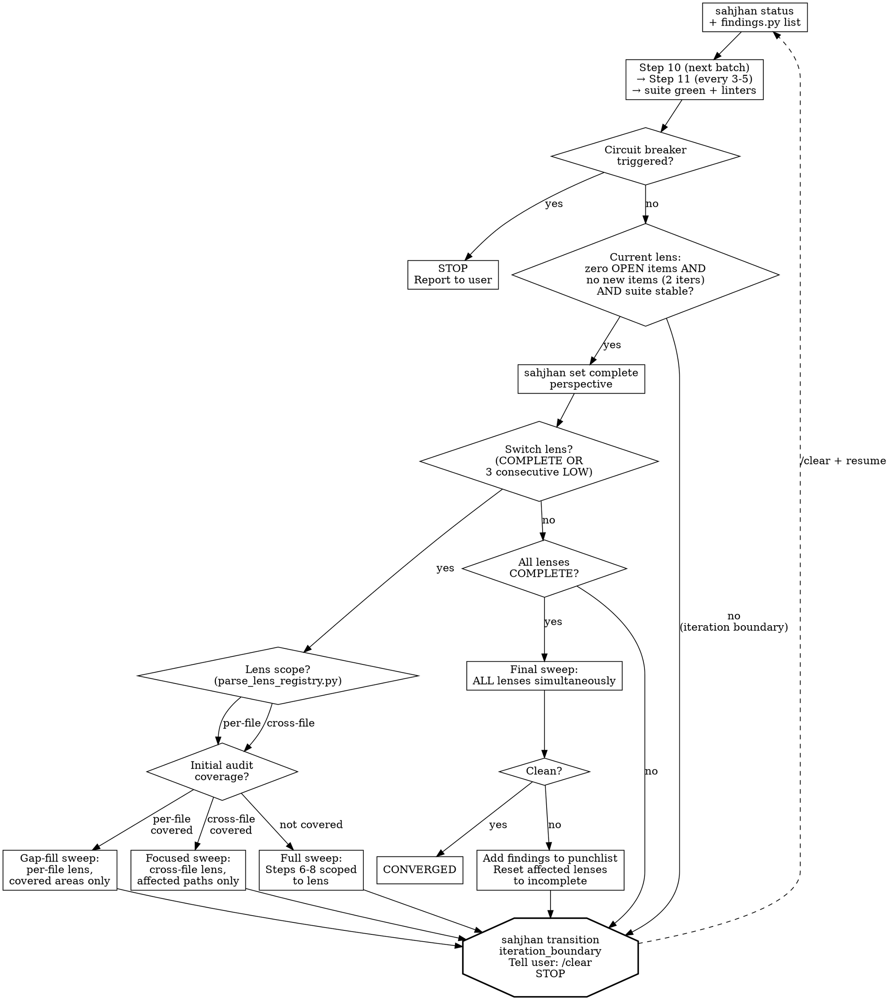

# Phase: Fix Loop (Steps 10-14)

> Core rules, rationalization red flags, and quick reference are in [../SKILL.md](../SKILL.md). Read that first if this is a fresh context.

<HARD-GATE>
Before entering the fix loop, read [references/step-10-fix-loop.md](references/step-10-fix-loop.md) and record:
`sahjhan --config-dir "$CLAUDE_PLUGIN_ROOT/enforcement" event reference_read --field path=step-10-fix-loop.md`
The `fix_loop_start` transition will not pass without this event.
</HARD-GATE>

<HARD-GATE>
**A context reset is mandatory between building the punchlist and the first fix.** `fix_loop_start` does **not** land you in `fix_loop` — it lands in `awaiting_clear`. The punchlist is now complete on disk; auditing it and fixing it are separate contexts. So:

1. Run `sahjhan --config-dir "$CLAUDE_PLUGIN_ROOT/enforcement" transition fix_loop_start` → you are now in `awaiting_clear`.
2. Tell the user to `/clear`. The turn stops; the daemon survives (it holds the session key). This is a context reset, **not** a stopping point — the run resumes after the clear.
3. After `/clear`, Claude Code fires a `SessionStart` that records the `context_reset` event, and the primer re-injects state on your next turn. **Re-read [references/step-10-fix-loop.md](references/step-10-fix-loop.md)** (your context was wiped) and the worklist from disk.
4. Run `sahjhan --config-dir "$CLAUDE_PLUGIN_ROOT/enforcement" transition resume` → now you are in `fix_loop`.

The `resume` gate requires a `context_reset` whose provenance is a real reset — `/clear`, a compaction, or a brand-new session. Nothing else can write one: it is not produced by sending a message, and a `--resume`/`--continue`/`/branch` session does not count, because those carry the old context forward. Talking your way past this gate is not available; the only way through is an actual reset (#79).

The same `awaiting_clear` boundary recurs mid-loop via `iteration_boundary` (Step 12). Entering fixes and resuming fixes use identical machinery.
</HARD-GATE>

### Step 10: TDD Fix Loop

Read [references/impact-graph-operations.md](references/impact-graph-operations.md) for blast radius queries and risk score updates.

**Re-read worklist.** Query it; do not read `docs/holtz/PUNCHLIST.md`. The fix loop works `user_reachable` findings only — `fix_commit` refuses the rest:
```bash
python3 ${CLAUDE_PLUGIN_ROOT}/skills/holtz/scripts/findings.py list --reachability user_reachable
```

A `fault_injected` finding is hardened in one commit per module at Step 15; a `theoretical` one is auto-deferred when it is filed. To move a finding onto the workable list, run a reachability probe and re-file it with `--field reachability=user_reachable` — the latest filing decides. Do not re-file to clear the gate without a probe that found a path.

#### Per-Item Fix Procedure (MANDATORY — do not skip steps)

Fixes are **delegated to subagents; the orchestrator merges and records.** You (the orchestrator) do not read a finding's code or author its test and fix in your own context — that is the subagent's job, and it is what keeps the main context under the ~300K budget (see SKILL.md → Context Survival Protocol). Each subagent does the **whole TDD cycle in its own enforced worktree** — writing the failing test, recording it, writing the fix, running the suite, committing. You keep the **merges and the protocol-state transitions**; those stay linear in one place.

**The subagent is under the same enforcement you are.** The hooks fire on a subagent's Bash/Edit exactly as they fire on yours, and the TDD gate is scoped to the caller: the pre-edit hook stops a subagent from writing a source fix until **that subagent** has recorded `test_failed_before_fix` since the last transition, and a sibling's does not count. Its `sahjhan event ...` calls write the same ledger you read. "Follow TDD" is not a request you make of the subagent in its prompt — it is mechanically unavoidable for it, just as it is for you. (This is why the subagent must run Sahjhan, not avoid it: recording the TDD events is exactly what unblocks its own edits.)

For each finding, in dispatch order:

**Step A — Dispatch the fix subagents (investigate + author + verify, each in its own worktree).**
Launch up to **3** Agent subagents at once, one finding each, with `isolation: "worktree"`. Give each: the finding (ID, description, location, category, Discovery Chain), which triage path it falls under (see [references/step-10-fix-loop.md](references/step-10-fix-loop.md)), the instruction to work **only** this finding, the name of the branch you merge onto (`git rev-parse --abbrev-ref HEAD`), and `$CLAUDE_PLUGIN_ROOT` so it can invoke Sahjhan.

**Model routing:** `model: "sonnet"` for a test that can't fail, or a fix confined to one file. Everything else → `model: "opus"`.

The subagent runs the enforced TDD sequence itself, in the real tree:

1. `sahjhan --config-dir "$CLAUDE_PLUGIN_ROOT/enforcement" event fix_start --field finding_id=BH-NNN`
2. Write a failing test that reproduces the finding. Run it. Confirm it FAILS. (Files under `tests/**` are exempt from the pre-edit gate, so this write is allowed.)
3. `sahjhan --config-dir "$CLAUDE_PLUGIN_ROOT/enforcement" event test_failed_before_fix --field finding_id=BH-NNN --field test_name=...`
4. Write the fix. (The pre-edit hook now allows the source edit because step 3 is on the ledger.) Run the failing test. Confirm it PASSES.
5. Run blast radius: `python3 ${CLAUDE_PLUGIN_ROOT}/skills/holtz/scripts/impact_graph.py --graph docs/holtz/impact-graph.json blast_radius <node> --depth 2`
6. `sahjhan --config-dir "$CLAUDE_PLUGIN_ROOT/enforcement" event blast_radius --field finding_id=BH-NNN --field affected_count=N`
7. Write ≥1 edge-case hardening test. Run it. Confirm it passes.
8. `sahjhan --config-dir "$CLAUDE_PLUGIN_ROOT/enforcement" event hardening_complete --field finding_id=BH-NNN --field edge_cases_tested=N`
9. **Once nothing else will touch the tree,** commit your worktree and rebase it onto the branch you were given:
   ```bash
   git add -A && git commit -m "fix(<scope>): <desc>" -m "BH-NNN"
   git rebase <branch>
   ```
   Commit exactly once. If the rebase conflicts, run `git rebase --abort`, record nothing, and return the conflicting paths — the finding goes back out, it does not get merged.

10. **Last, after the rebase:** `python3 ${CLAUDE_PLUGIN_ROOT}/enforcement/scripts/verify_suite.py --record --scope affected` — runs the tests covering your change (widens to full if it can't prove the subset), records `suite_green` for this tree. Red records nothing.

   Ordering is load-bearing: the green is bound to a hash of the working tree, so **any** later edit — the hardening test above especially — invalidates it, and the orchestrator's step 11 would then reject a fix that is perfectly good. The rebase moves the tree too, which is why it comes first. Record after the last write, not before.

   **Run it alone on its own Bash line.** Chaining anything before or after it (`&&`, `;`, `|`) records nothing. A green run with no `suite_green` at step 11 is almost always this.

The subagent returns a **compact result**, not artifacts to apply: root cause + confidence (`bug/*` needs HIGH confidence before any fix), the blast-radius node, the test name(s), the suite pass-count, and its worktree's branch. The edits, the commit and the ledger events are already on disk — that is the whole point. The subagent does **NOT** run any `transition`; those are yours.

If the subagent cannot reach HIGH confidence, it records nothing, leaves the tree clean, and returns its investigation notes plus a recommendation (defer-low / defer-medium / can't-reproduce with evidence). You then follow the deferral path in [references/step-10-fix-loop.md](references/step-10-fix-loop.md) — do not invent a fix.

**Step B — Orchestrator merges and records.** You author and apply nothing. Take finished subagents **one at a time**, in the order they finish:

11. **Merge, then validate — read the evidence, don't redo it.** `git merge --ff-only <worktree-branch>`. A refusal means the subagent's rebase is stale; send it back. Then `python3 ${CLAUDE_PLUGIN_ROOT}/enforcement/scripts/verify_suite.py --check --scope affected` exits 0 only if a `suite_green` names *this exact tree*, and the ledger must show this finding's `test_failed_before_fix` and `hardening_complete` (`sahjhan --config-dir "$CLAUDE_PLUGIN_ROOT/enforcement" status`). If either fails, the fix is not real — send it back or defer; do not record it.
12. `sahjhan --config-dir "$CLAUDE_PLUGIN_ROOT/enforcement" transition fix_commit BH-NNN` — the item id is **positional** (`item_id=BH-NNN` also works); the CLI rejects `--item-id`. Its suite gate re-reads the same `suite_green` step 11 did: the tree hash names content, and a fast-forward merge does not change content, so no second run is needed. **This transition auto-records the `finding_resolved` event for BH-NNN** (id from the arg, commit hash from `HEAD`, run context inherited from the ledger). That resolution event — not the transition itself — is what marks the finding resolved for STATUS.md / PUNCHLIST.md "Resolved" counts and every downstream gate (`pattern_check`, `set complete perspective`, `converge`). You do **not** record `finding_resolved` by hand; one command does both. (Emitted by sahjhan ≥ 0.18.0; the pin is enforced by `scripts/check_sahjhan_pin.py`.)
13. Move to the next finished subagent.

Merge and record **one subagent at a time** — the ledger is a single hash chain, so the transitions stay linear. The subagents run concurrently: each holds its own worktree, so its tree hash is its own, and each is gated by the **same** TDD pre-edit hook you are, keyed on the actor that recorded the failing test. A subagent cannot write its fix (step 4) before recording `test_failed_before_fix` (step 3), and a sibling's failing test does not authorise it. Its `suite_green` is bound to a tree hash rather than to its word — that pair is what lets you merge on a ledger read instead of a second suite run.

#### Fix Loop Output Rules

**During the fix loop, do not write explanatory text between fixes.**
Your output should be:
- Tool calls (test writes, edits, bash commands)
- One-line status after each fix_commit: "FIX N/M: BH-NNN resolved. Suite: X pass."
- Nothing else until convergence.

If you find yourself writing a summary table, STOP. You are not in the finalize phase.

### Step 11: Pattern Analysis [recurring: every 3-5 fixes during Step 10, through round 8]

From round 9 on, run [Step 11b](#step-11b-stale-sweep-recurring-at-each-iteration-boundary) in place of this step — its record discharges the owed round.

Use extended thinking (ultrathink) for this step — cross-finding pattern discovery and sibling search require deep reasoning.

Two ways to run it:

- **Stay in `fix_loop`** (usual). Do steps 1-5. Step 5 satisfies the `iteration_boundary` gate.
- **Enter `pattern_analysis`**, when `iteration_boundary` blocks you and names `pattern_check`. Run `sahjhan --config-dir "$CLAUDE_PLUGIN_ROOT/enforcement" transition pattern_check`, do steps 1-5, then `sahjhan --config-dir "$CLAUDE_PLUGIN_ROOT/enforcement" transition pattern_done`, gated on step 5.

When `pattern_done` reports amplification, run this, then `pattern_done` again:

```bash
sahjhan --config-dir "$CLAUDE_PLUGIN_ROOT/enforcement" defer batch --severity low,medium
```

1. **Read every finding, open and closed:**
   ```bash
   python3 ${CLAUDE_PLUGIN_ROOT}/skills/holtz/scripts/findings.py list --all
   ```
   Use `findings.py show BH-NNN` for a finding's full record.
2. Group resolved items by category. Also compare Discovery Chains across items — items in different categories but with similar chains may share a root cause. For groups of 2+: identify the pattern, search for siblings, record each sibling with `sahjhan --config-dir "$CLAUDE_PLUGIN_ROOT/enforcement" event finding --field pattern_id=PAT-NNN` IMMEDIATELY — one call per sibling, before the next group. At most 3 of a round's siblings may still be open when the round ends. Merge a sibling that repeats a finding already on the board — `BH-MMM` is that finding, open or already fixed:

   ```bash
   sahjhan --config-dir "$CLAUDE_PLUGIN_ROOT/enforcement" transition merge_finding BH-NNN BH-MMM
   ```

   `iteration_boundary` also requires the run to have closed or merged at least as many findings as the round opened. Past 25 open findings carrying a `pattern_id`, no round is owed until they are closed.
3. **Update impact graph:** Add `shares_pattern` edges between all instances of the same pattern (e.g., if BH-003 and BH-007 are both PAT-001 instances, link the functions they involve with `shares_pattern` edges including the pattern ID in the note).
4. **Read the pattern brief compact. Never `Read` it whole:**
   ```bash
   python3 ${CLAUDE_PLUGIN_ROOT}/skills/holtz/scripts/pattern_brief_compact.py docs/holtz/patterns-brief.md
   ```
   Read one `PAT-NNN`'s full entry from `docs/holtz/patterns-brief.md` only when updating that entry.
5. **Update `docs/holtz/patterns-brief.md`.** Append each new pattern in this format:

   ```markdown
   ## PAT-{NNN}: {name} (Run {R}, {date})
   **What to look for:** {1-2 sentences: the specific code shape or practice that indicates this bug class}
   **Detection heuristic:** {grep pattern, structural check, or question to ask about the code}
   **Example:** {one concrete instance from a prior finding, anonymized to the pattern level}
   ```

   If the file does not exist, create it with this header:

   ```markdown
   # Holtz Pattern Brief

   > Read this before starting any audit work. These patterns were discovered
   > in prior audits of this project. Check for them in the code you're reviewing.
   ```

   **Deduplication:** Before appending, check if the new pattern is a refinement of an existing entry (same bug class, similar detection heuristic). If so, update the existing entry with improved heuristics or examples rather than adding a duplicate.

   **Rolling policy:** The brief is capped at 20 active entries and 40 KB. When a new pattern would push the count past 20, move the 5 oldest entries (by discovery date) in a single batch to `docs/holtz/patterns-brief-archive.md`. The archive uses the same format but is not read by subagents by default. If the archive file does not exist, create it with the same header but titled `# Holtz Pattern Brief — Archive`. Compress every entry over 2 KB to the four lines above and move what does not fit to `docs/holtz/pattern-round-NN.md`, NN being this round's number, linked from the entry's **Example:** line. Step 4's compact read names the entries and briefs that are over.

6. **Record the round.** After step 5, alone on its own Bash line — chaining records nothing:
   ```bash
   python3 ${CLAUDE_PLUGIN_ROOT}/enforcement/scripts/pattern_round.py --record --siblings-found M
   ```
   `patterns_found` is counted from the brief's `## PAT-NNN:` headings; an entry appended after this waits for the next round.

### Step 11b: Stale Sweep [recurring: at each iteration boundary]

Triage every open finding, at every severity, in one pass, before dispatching another fix.

1. List every open finding:
   ```bash
   python3 ${CLAUDE_PLUGIN_ROOT}/skills/holtz/scripts/findings.py list
   ```
2. Dispatch **one** subagent for the whole set, with the listing and `$CLAUDE_PLUGIN_ROOT`. It reads the code at each location, runs the finding's recorded probe where there is one, and returns *still present* or *not reproducible* with evidence. It writes no code and records no events.
3. For each finding it could not reproduce, one at a time:
   ```bash
   sahjhan --config-dir "$CLAUDE_PLUGIN_ROOT/enforcement" event fix_start --field finding_id=BH-NNN
   ```
   Write the evidence to `docs/holtz/investigations/BH-NNN.md` ([format](investigation-format.md)), then:
   ```bash
   sahjhan --config-dir "$CLAUDE_PLUGIN_ROOT/enforcement" defer cant-reproduce BH-NNN
   ```
   Record each `fix_start` after the previous deferral, not ahead of the batch — its gate is scoped to the last transition.
4. **Record the sweep.** After step 3, alone on its own Bash line — chaining records nothing:
   ```bash
   python3 ${CLAUDE_PLUGIN_ROOT}/enforcement/scripts/stale_sweep.py --record --present BH-NNN,BH-NNN --retired BH-NNN
   ```
   Every id from step 1 goes in one list or the other. Run with `--show` for the ids the sweep must account for.

### Step 12: Per-Fix Hardening [recurring: after each fix in Step 10]

After each fix: edge case variants (null, empty, boundary, concurrent), regression tests for similar code paths.

### Step 13: Blast Radius Check [recurring: after each fix in Step 10]

After each fix: impact graph 2-hop query. Check downstream assumptions. If an assumption is violated, create a new punchlist item.

### Step 14: Lens Rotation

Read [references/lens-registry.md](references/lens-registry.md) for the full set of analytical lenses. The convergence loop rotates through lenses. True convergence requires ALL lenses clean in the same final sweep.

**Determine sweep strategy per lens.** Run `python3 ${CLAUDE_PLUGIN_ROOT}/skills/holtz/scripts/parse_lens_registry.py` and read `docs/holtz/audit/lens-coverage.md` (written after Steps 7-8). The sweep strategy depends on lens scope and initial audit coverage:

| Scope | Initial Coverage | Sweep Strategy |
|-------|-----------------|----------------|
| per-file | covered | **Gap-fill:** Audit only files not covered in initial audit (new files, files changed by fixes, files missed by subagent batching). Record `sweep_type=gap-fill`. |
| per-file | not covered | **Full:** Standard Steps 6-8 scoped to this lens. Record `sweep_type=full`. |
| cross-file | covered | **Focused:** Re-trace entry points from lens registry using updated impact graph. Focus on paths affected by fixes since initial audit. Record `sweep_type=cross-file-focused`. |
| cross-file | not covered | **Full:** Standard Steps 6-8 scoped to this lens entry point. Record `sweep_type=full`. |

For each lens sweep, record: `sahjhan --config-dir "$CLAUDE_PLUGIN_ROOT/enforcement" event lens_sweep_started --field perspective={lens} --field sweep_type={type}`

**Gap-fill sweep procedure (per-file lenses with initial coverage):**
1. Read `docs/holtz/audit/lens-coverage.md` for which files were covered
2. Identify gaps: files created/modified since initial audit (`git diff --name-only` from audit commit), plus any files not in subagent batches
3. Dispatch a subagent with the gap files and the lens's audit priorities
4. Write findings to `docs/holtz/audit/lens-{name}.md`

**Focused sweep procedure (cross-file lenses with initial coverage):**
1. Read the lens's initial audit output at `docs/holtz/audit/lens-{name}.md`
2. Query impact graph for edges relevant to this lens's entry point
3. Focus on paths that include nodes modified by fixes since the initial audit
4. Dispatch a subagent with the focused path list and lens audit priorities
5. Write findings to `docs/holtz/audit/lens-{name}.md` (append or replace)

After completing a lens sweep (any type), return to Step 10 (fix loop) for any new findings. When a perspective passes clean, run `sahjhan --config-dir "$CLAUDE_PLUGIN_ROOT/enforcement" set complete perspective <name>`. Then run `sahjhan --config-dir "$CLAUDE_PLUGIN_ROOT/enforcement" transition lens_rotate` to switch to the next perspective.

**Three transitions need a `full` green first** — `iteration_boundary`, `set complete perspective`, `converge`. Run `python3 ${CLAUDE_PLUGIN_ROOT}/enforcement/scripts/verify_suite.py --record --scope full` before each. This is the periodic whole-suite run that re-bases what `--scope affected` measures against; per-fix greens never satisfy it.

**Circuit Breakers:**
- **MAX_ITERATIONS:** 15 fixes **per iteration window**. Enforced by Sahjhan's `fix_commit` circuit-breaker gate, which counts `fix_commit`s *since the last `iteration_boundary`* — so the cap resets at each `/clear`. If a single uncleared window hits 15, run `iteration_boundary` + `/clear` to continue (or report remaining items). Whole-run convergence is **not** capped: a long audit fixes >15 findings across multiple windows (fixed in #67; a prior lifetime cap made >15-finding audits unconvergeable).
- **SAME_ITEM:** 3 attempts on the same punchlist item. After 3, escalate to the user.
- **NO_PROGRESS:** 3 consecutive iterations with no items resolved. Stop and report.
- **CONTEXT_BUDGET:** If context utilization exceeds 60%, wrap up the current item and proceed to the convergence boundary — run `sahjhan --config-dir "$CLAUDE_PLUGIN_ROOT/enforcement" transition iteration_boundary` and instruct `/clear`. Do not wait for compaction.

**Answering the user mid-loop (#69).** If the user asks you something that genuinely needs the turn handed back, run `sahjhan --config-dir "$CLAUDE_PLUGIN_ROOT/enforcement" transition pause` first. It moves `fix_loop -> awaiting_human`, which is the one non-terminal state the Stop hook lets you stop in — and unlike `! sahjhan daemon stop` it keeps the daemon and the session key alive, so `sahjhan --config-dir "$CLAUDE_PLUGIN_ROOT/enforcement" transition resume` picks the run straight back up. There is no gate on either direction; pausing to talk to a human is always legitimate.

This is **not** a licence to ask whether to continue. Continuing is the default (see SKILL.md's Autonomy section) — `pause` is for a question the user actually asked, not for converting a blocked gate into "how would you like me to proceed?"

**Test / lint command for non-standard targets.** `verify_suite.py` runs the suite; the perspective-completion and `converge` gates still run the linter directly. Both resolve via the `PATH` of the shell you invoke them from. If the target's tests only run under a venv/pyenv/conda/poetry/tox, export an override **once at run start**:

```bash
export HOLTZ_PYTEST='.venv/bin/python -m pytest -x --ff --tb=short -q'  # or: poetry run pytest / tox / ...
export HOLTZ_LINT='.venv/bin/ruff check .'                             # or: poetry run ruff check .
```

Unset, these default to `python3 -m pytest -x --ff --tb=short -q` and `ruff check .`. Do not put `--lf`/`--last-failed` in `HOLTZ_PYTEST`: it runs only the previously-failing tests, so a green would mean nothing. When a gate command fails, Sahjhan surfaces a tail of its stderr in the block reason (sahjhan ≥ 0.16.0, holtz #63).


